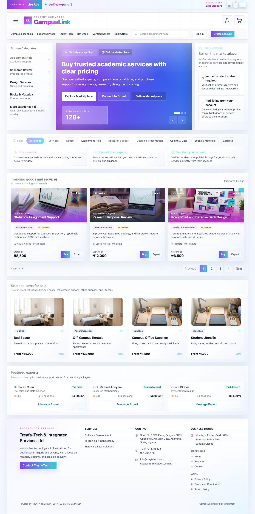
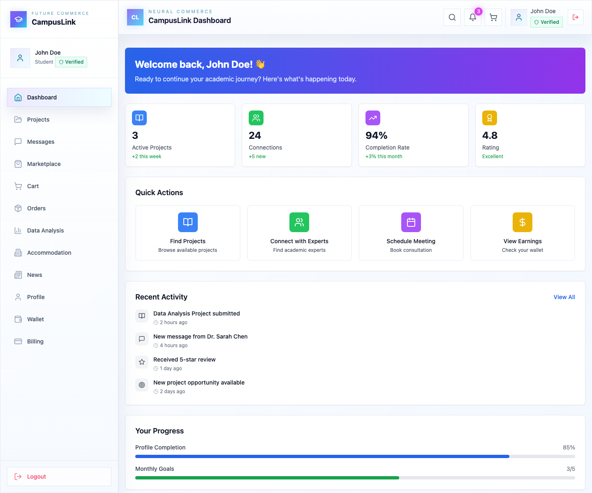
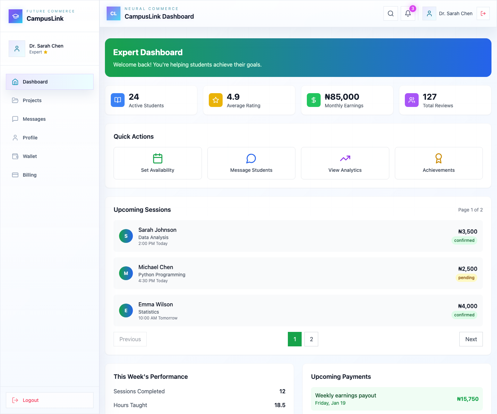

# CampusLink

CampusLink is a multi-role campus marketplace and academic support platform built with `React`, `TypeScript`, `Vite`, and `Tailwind CSS`. It combines a public-facing marketplace with authenticated workspaces for students, experts, institution representatives, and super administrators, and it can be served either as a standard Vite app during development or through a lightweight Python host for production-style local preview.

## What the project does

CampusLink is designed as a campus commerce and services hub. Students can browse academic services and physical goods, manage carts and orders, access a wallet, explore accommodation listings, use data-analysis tools, and follow campus news. Experts can manage their work and earnings, institutions can oversee campus-facing activity, and super admins get a platform-level administrative view.

The current implementation is a polished frontend demo with local session and commerce state stored in the browser. Authentication, cart contents, orders, wallet history, registration data, and most workspace behavior are mocked for product demonstration and UI validation.

## Main capabilities

| Area | What is included |
| --- | --- |
| Public marketplace | Browse listings, category pages, search flows, product images, seller highlights, and calls to sign in or register |
| Authentication | Guided login flow, registration for student/expert/institution accounts, mock demo accounts, local session persistence |
| Student workspace | Marketplace, cart, checkout, orders, projects, messages, profile, wallet, billing, accommodation, data analysis, and news |
| Expert workspace | Dashboard, projects, messages, profile, wallet, and billing |
| Institution workspace | Dashboard, projects, messages, profile, wallet, and billing |
| Super admin workspace | Dashboard, profile, wallet, and billing |
| Payments | Optional Paystack client integration for checkout, subscriptions, and wallet top-up |
| Hosting | React development server via Vite or production-style serving through the Python host in `flet_webapp` |

## Roles and demo accounts

Use these built-in accounts to explore the different interfaces:

| Role | Email | Password |
| --- | --- | --- |
| Student | `john.doe@university.edu` | `password123` |
| Expert | `sarah.chen@gmail.com` | `expert123` |
| Institution | `admin@techuniversity.com` | `admin123` |
| Super admin | `admin@campuslink.com` | `admin123` |

## Tech stack

### Frontend

- `React 18`
- `TypeScript`
- `Vite`
- `Tailwind CSS`
- `lucide-react`

### Payments and service hooks

- `@paystack/inline-js` for optional live payment flows
- `@supabase/supabase-js` is installed, though the current shipped experience is still primarily mock-data driven

### Python host

- `FastAPI`
- `uvicorn`
- A small Python app in `flet_webapp/app.py` that serves the built React `dist/` output

## Project structure

```text
CampusLink Flet/
├── src/
│   ├── components/
│   │   ├── Accommodation/
│   │   ├── Auth/
│   │   ├── Billing/
│   │   ├── Cart/
│   │   ├── Checkout/
│   │   ├── Dashboard/
│   │   ├── DataAnalysis/
│   │   ├── Legal/
│   │   ├── Marketplace/
│   │   ├── Messages/
│   │   ├── Mobile/
│   │   ├── Navigation/
│   │   ├── News/
│   │   ├── Orders/
│   │   ├── Profile/
│   │   ├── Projects/
│   │   ├── UI/
│   │   └── Wallet/
│   ├── hooks/
│   ├── types/
│   └── App.tsx
├── public/
│   └── marketplace-images/
├── documentation/
│   └── screenshots/
├── flet_webapp/
│   ├── app.py
│   ├── requirements.txt
│   ├── README.md
│   └── test_commerce.py
├── package.json
└── README.md
```

## Run locally

### Option 1: run the React app in development mode

This is the fastest option while editing the UI.

```bash
npm install
npm run dev
```

Then open the local Vite URL shown in the terminal.

### Option 2: build React and serve it through Python

This uses the Python host in `flet_webapp` to serve only the React build output.

```bash
npm install
npm run build
python3 -m venv flet_webapp/.venv
flet_webapp/.venv/bin/python -m ensurepip --upgrade
flet_webapp/.venv/bin/python -m pip install -r flet_webapp/requirements.txt
CAMPUSLINK_PORT=8551 flet_webapp/.venv/bin/python flet_webapp/app.py
```

Then open `http://localhost:8551/`.

## Environment setup

Paystack is optional in the current project. Without a public key, wallet top-up, billing subscriptions, and non-wallet checkout paths stay in demo mode and show configuration prompts.

Create a `.env.local` file in the project root if you want to enable the Paystack client flow:

```bash
VITE_PAYSTACK_PUBLIC_KEY=your_paystack_public_key
```

## How state works today

The project currently uses browser `localStorage` for most user-facing state. That includes:

- active user session
- registered demo-created accounts
- cart items
- order history
- wallet data

This makes the app easy to demo and test without setting up a backend, but it also means the data is local to a single browser profile.

## Screens included

The project includes a refreshed screenshot set in `documentation/screenshots/` for the current React interface.

### Key screens

- Public marketplace: `documentation/screenshots/marketplace-public.png`
- Login access: `documentation/screenshots/auth-login-access.png`
- Register: `documentation/screenshots/auth-register.png`
- Student dashboard: `documentation/screenshots/student-dashboard.png`
- Student marketplace: `documentation/screenshots/student-marketplace.png`
- Student checkout: `documentation/screenshots/student-checkout.png`
- Expert dashboard: `documentation/screenshots/expert-dashboard.png`
- Institution dashboard: `documentation/screenshots/institution-dashboard.png`
- Super admin dashboard: `documentation/screenshots/super-admin-dashboard.png`

### Preview gallery







## Commands

```bash
# install frontend dependencies
npm install

# start Vite development server
npm run dev

# create production build
npm run build

# lint the frontend
npm run lint

# preview built frontend with Vite
npm run preview

# run Python host tests
flet_webapp/.venv/bin/python -m unittest discover -s flet_webapp -p 'test_*.py' -v
```

## What to know before extending it

- The current experience is frontend-first and demo-oriented.
- Checkout and billing flows are partially gated by `VITE_PAYSTACK_PUBLIC_KEY`.
- The Python host serves the React build only; it does not render a separate Flet UI.
- The UI already includes role-aware routing, responsive mobile navigation, marketplace categories, and image-based product cards.

## Suggested next steps

- connect authentication and commerce flows to a real backend
- persist orders, messages, and profiles in a database instead of `localStorage`
- add an `.env.example` file for faster onboarding
- add automated frontend tests for the main role flows
- document every screenshot in a dedicated `documentation/screenshots/README.md`
