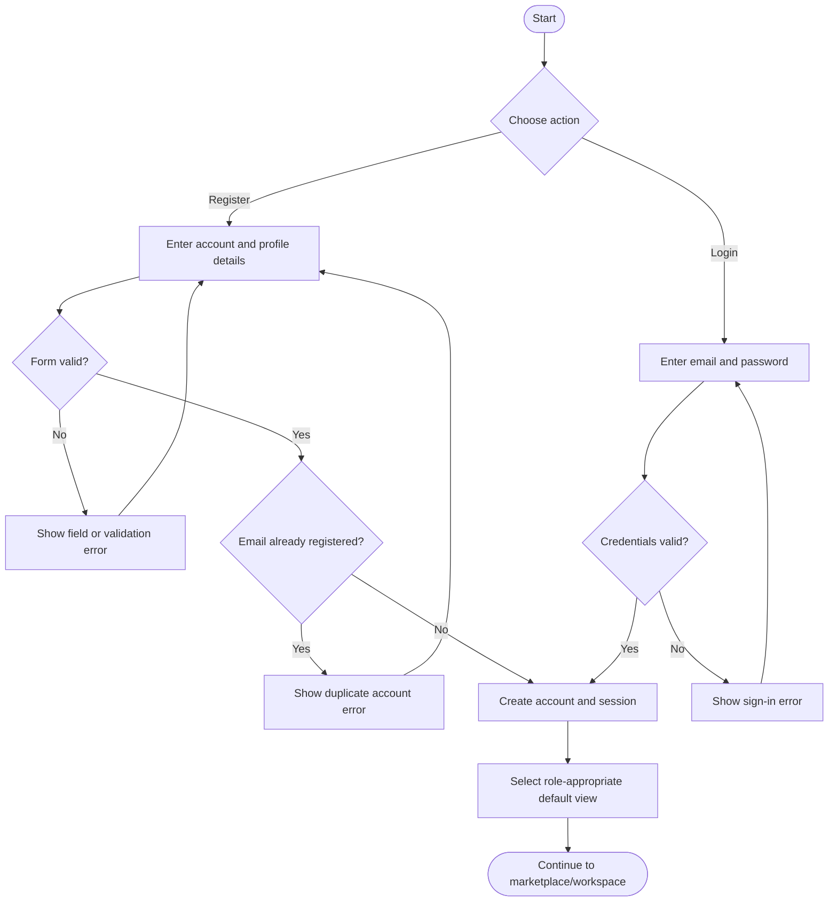
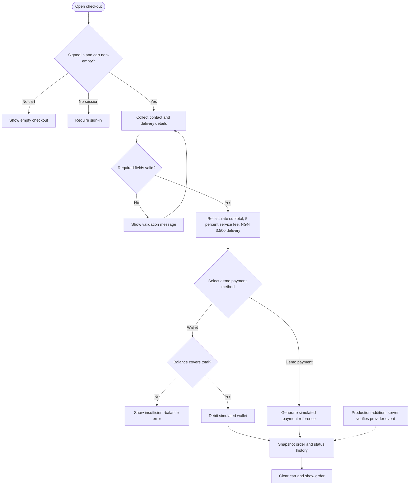
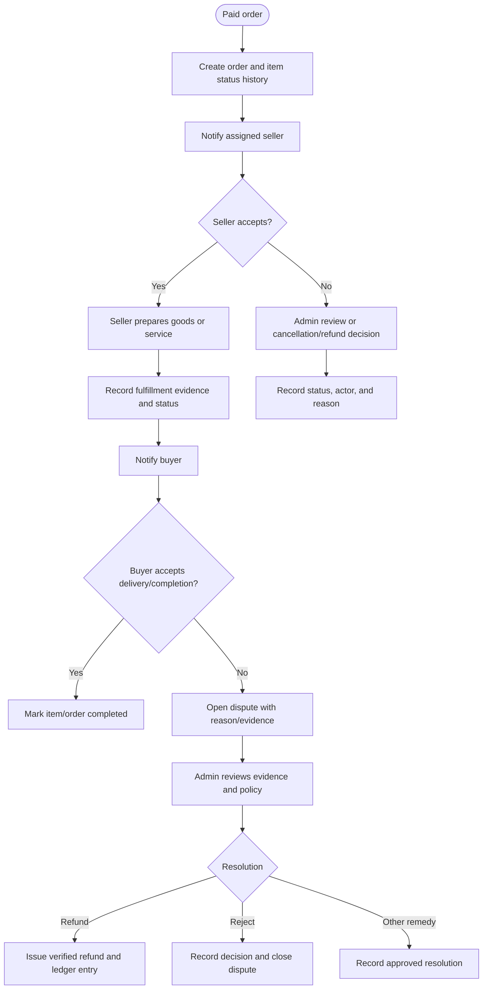

# 5. Flowcharts

The first two diagrams describe the intended user path alongside current demo behavior. The fulfillment diagram is a production target because the current UI does not provide a status-update workflow.

## Registration and login

**Current note:** the validation and account lookup use the frontend demo provider and local storage, not a server identity service.

## Checkout (Flet demo)

The Flet flow does not collect card/bank details and does not charge real funds. Server/provider confirmation is a production requirement, not a current guarantee.

## Order fulfillment (production target)

The Flet demo now supports local, guarded status transitions and stores status history with each browser-local order. This diagram extends that flow with seller/buyer authorization, notifications, evidence, and dispute resolution; those production capabilities are not implemented.
