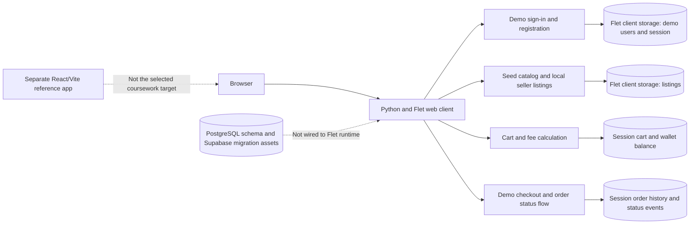
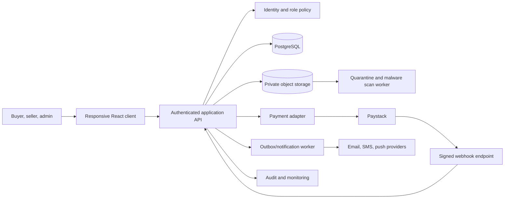
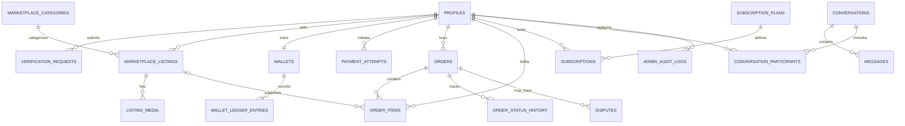

# 7. System Design

## Design boundary

The design has two distinct views: **current Flet web demo architecture** and **proposed production architecture**. The PostgreSQL schema and Supabase migration are design assets; the selected Flet runtime uses browser client storage for account, listing, cart, wallet, and order state. Do not infer production persistence or authorization from the schema alone.

## Current architecture

## Proposed production architecture

The API, server verification, malware scanner, notification worker, and audit integration in this diagram are **proposed**, not current Flet services.

## Database design

The repository's `database/schema.sql` defines the following relational groups. Monetary columns in the schema use integer kobo; Flet demo values are integer NGN, so conversion and rounding rules must be centralized before database persistence.

| Domain | Main tables | Purpose |
|---|---|---|
| Identity and verification | `profiles`, `verification_requests`, `verification_documents` | User role/profile and verification request/document metadata. |
| Marketplace | `marketplace_categories`, `marketplace_listings`, `listing_media` | Catalog, category, listing state, and media references. |
| Payment and wallet | `wallets`, `wallet_ledger_entries`, `payout_accounts`, `payment_attempts` | Balances, ledger history, withdrawal destinations, and provider attempts. |
| Orders | `orders`, `order_items`, `order_status_history` | Buyer order, immutable listing snapshots, and status history. |
| Premium | `subscription_plans`, `subscriptions` | Plan catalog and user subscription lifecycle. |
| Messaging and disputes | `conversations`, `conversation_participants`, `messages`, `message_attachments`, `disputes` | Communication, attachments, and order dispute resolution. |
| Governance | `system_settings`, `admin_audit_logs` | Platform settings and administrative action history. |

### Core entity relationships

The diagram is a high-level view. Column types, constraints, indexes, enum values, and triggers are in `../database/schema.sql`.

## Input, output, and interface design

| Interface | Inputs | Outputs / feedback | Current surface |
|---|---|---|---|
| Registration | Name, email, password/confirmation, account type, profile fields | Validation feedback or local account/session | Flet auth dialog |
| Sign-in | Email and password | Error or role-specific workspace | Flet auth dialog |
| Marketplace | Search text, category, listing selection | Filtered cards, details dialog, cart action | `build_marketplace_panel` |
| Seller listings | Kind, category, title, description, price, location, delivery | Local listing create/edit/pause/delete | `build_listings`, `save_listing` |
| Cart | Product, quantity delta, remove/clear action | Items, subtotal, service fee, delivery fee, total | `build_cart` |
| Checkout | Name, email, phone, address, note, demo/wallet method | Validation or locally stored simulated order | `build_checkout`, `place_order` |
| Orders | Current user's local orders, selected allowed status | Snapshots, payment reference, status history | `build_orders`, `update_order_status` |
| Admin | Dashboard tabs and controls | Demo metrics and management views | `build_dashboard` |

For production, every form needs server validation, accessible labels/error messaging, server permission checks, and a durable audit trail for sensitive actions.

## Design constraints and decisions

- Keep order item title/price/seller snapshots so later listing edits do not rewrite a buyer's receipt.
- Use integer minor currency units in persistent records and document one rounding policy for fee calculation.
- Enforce role and record ownership on the server; hiding a client button is not authorization.
- Keep KYC documents private, use temporary quarantine storage and scan before release, and restrict staff access.
- Verify payment events on the server and make order creation idempotent.
